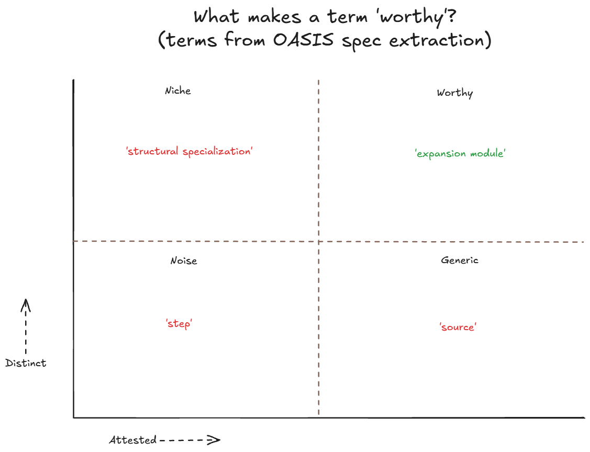
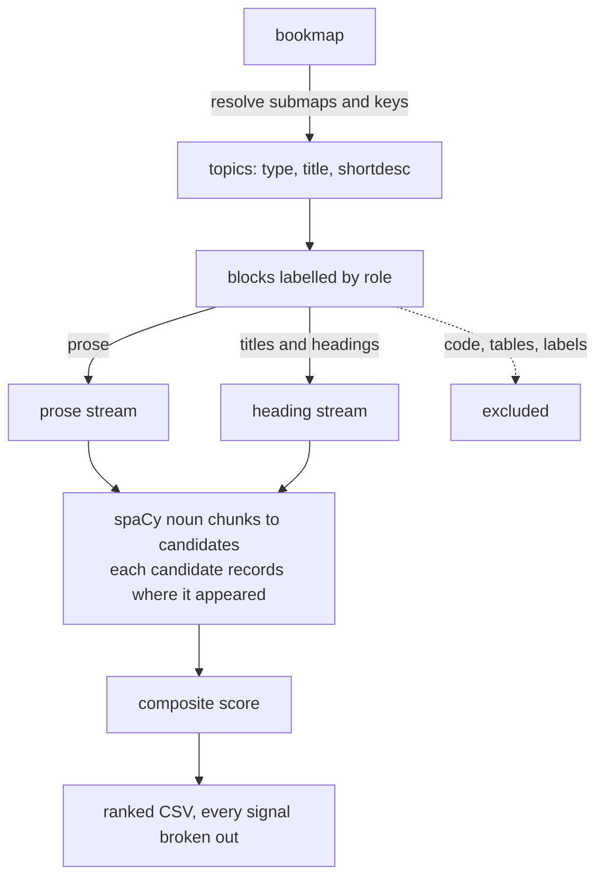

# termex: structure-aware term extraction from DITA

> **Note:** This showcase is a small, scoped, and abstracted recreation of an enterprise glossary extraction and management project I worked on in early 2026. All data here was extracted from public DITA libraries. The code, the results section and the housekeeping sections at the end were written by AI and are clearly marked. The rest of the write-up was written by me.

This project was born from a need to extract sound, high-quality glossary terms from a documentation corpus written in DITA. In this write-up I describe the method I used and the ideas behind the extractor.

Structure-aware NLP is not new, but what I hope this adds is a treatment of *meeting documents where they stand*: DITA documentation is already rich with its authors' judgements during the act of drafting itself.

## What this is

How do you bootstrap a human-verifiable list of domain-specific terms from dense, structured technical documentation? This README is a technical write-up of an extraction process converting DITA-source documentation into a sorted, ranked candidate list.

I'll go over the pipeline with my design decisions and how they relate to the inherent structure, including:
- the definition of 'worthiness' in documentation (distinctiveness × attestation),
- the specific signals for attestation and distinctiveness, and why we chose these signals,
- how scoring with and without structure performs against real documentation.

Data models, merges, and downstream uses (AI-based drafting against real documentation) are mostly out of scope for this write-up, but I'll touch lightly on them at the end.

## Sorting candidate signals from noise

For documentation that lacks an existing glossary, we come up against the fact that we'll inevitably have thousands of 'raw' noun-phrase candidates that come up, especially in particularly dense documentation (the OASIS DITA 2.0 specification alone yields 4,502 candidates from 515 topics; the Oxygen user guide yields 18,292). For a short guide, this may be hand-pickable, but it quickly becomes tricky at scale.

The challenge, then, is picking terms that fit what the document is trying to say. There is a 'Goldilocks' zone for a candidate in the context of the document where it is:
- NOT a commonly used word like 'user', whose meaning is self-evident (in the Oxygen user guide, 'user' appears 288 times across 162 topics).
- NOT a unicorn, i.e., a candidate that appears only once, or appears multiple times but in only one isolated topic. In the OASIS spec, 2,603 of 4,502 candidates (about 58%) appear exactly once. We're accepting here that glossaries *do* often index rare terms. But for a glossary retrospectively derived from established documentation, a rare term earns its place only when the document vouches for it.

In essence, we're defining a glossary term as a worthy domain concept that a reader needs defined. So what would we consider 'worthy'?

## What makes a term worthy?

The extraction turns on the definition of worthiness, which we'll define as follows:
> a term is worthy to its domain if it's **distinct to it** and **attested by it**.

Distinctiveness refers to how unique a term is to its domain; in other words, how much a document *owns* the term. There are a few signals that point to this, such as single words that are uncommon in ordinary English, or cohesion for multi-word phrases. We'll get to specific techniques for mining distinctiveness later on.

Attestation refers to how much a term is grounded in its domain — how much a document *vouches for* the term. A document vouches for a term when it's given a prominent spot in the document itself (say, a title, or a topic's short description), or when it defines it outright (as in "X is a Y"-type definitional sentences).

Plotting a given set of candidates from a document corpus along these axes gives us this general picture, broadly speaking.



## From DITA to a corpus index

I write in DITA, which is a useful coincidence because as a structured XML doc format, it already encodes a lot of useful semantic information in its structure. More broadly speaking, though, I do want to argue for the power of extraction *along* the structural grooves of content, rather than against it, or trying to smooth things out. For retrospective extraction, we need as much of the already-existing content to help us out as possible.

DITA has a few inherent features that give us a lot of content awareness for free, as opposed to flatter document standards. It contains natural partitions in content with individual topic files, and semantic tags that embed relational information. For instance, `<shortdesc>` is meant to sit at the top of a file as a summary of the topic at large. (DITA also contains a `<term>` tag, but marking a phrase as a term is usually at the mercy of individual authors, and can be unreliable or unenforced.)

> Diagram drafted with AI.



## How the axes are measured

For **distinctiveness**, we borrow two ideas from term-extraction literature (Kageura and Umino 1996): unithood, whether a phrase's words hold as a unit, and termhood, the degree to which the unit is tied to a concept specific to the domain.

This generally maps onto our approach for single- and multi-word terms:
- Single words: We use a threshold score of Zipf 4 (about 10 occurrences per million words) as the bound between low- and high-frequency words (van Heuven et al. 2014). What this means is that a word scoring ≥ 4 in wordfreq, a general-English frequency list, is penalized as common English.
- Multi-word phrases: C-value, which measures phrase 'parenthood': a phrase that mostly appears embedded in a longer one scores low (in the DITA spec, 'element configuration' appears 6 times on its own but 30 times inside 'element-configuration modules'), and pointwise mutual information (PMI), which measures how tightly words in our corpus appear together (for example, the word 'Puerto' is almost always found with 'Rico'). Phrases also take the common-word penalty, in proportion to how many of their words score ≥ 4.

For **attestation**, we look at where terms are located within a document itself. Structured documentation gives us a strong base for this; a term earns credit when a topic is titled with it, when it appears near the top of a topic (as in a `<shortdesc>`), or when the document defines it in an "X is a Y" definition.

These fold into a composite score that candidates within the corpus are ranked against.

## What the test results show

I wanted to test whether 'structure-aware' term extraction outperforms a flat extraction, and by how much.

> Drafted with AI from the evaluation outputs.

The test ranks the same candidate list two ways, flat (frequency, C-value and PMI alone) and structural (every signal above, plus a small penalty for phrases that appear mostly in headings), and checks which one puts each corpus's own glossary terms nearer the top. It uses three public corpora: the OASIS DITA 2.0 specification (515 topics, 63 glossary terms), the DITA-OT documentation (204 topics, 14 terms) and the Oxygen XML user guide (2,030 topics, 50 terms). Glossary and terminology topics are removed before extraction, so the answers aren't in the input. The score is precision at N (P@N): the share of the top N candidates that are glossary terms.

| Corpus | P@10 flat | P@10 structural | P@25 flat | P@25 structural |
|---|---|---|---|---|
| OASIS DITA 2.0 specification | 0.10 | 0.40 | 0.08 | 0.20 |
| DITA-OT documentation | 0.20 | 0.10 | 0.08 | 0.08 |
| Oxygen XML user guide | 0.10 | 0.00 | 0.04 | 0.08 |

Structure helps most on the OASIS specification, where precision at 10 quadruples. On DITA-OT and Oxygen the picture is mixed, and by rank 50 flat overtakes structural everywhere but Oxygen.

Single words show the effect most clearly, since they get no unithood credit at all. Of the 32 single-word glossary terms across the three corpora, 25 rank higher under structural, and these four reach its top 100:

| Glossary term | Corpus | Flat rank | Structural rank |
|---|---|---|---|
| constraints | OASIS | 2,546 | 7 |
| generalization | OASIS | 2,640 | 8 |
| domains | OASIS | 2,544 | 58 |
| Plugin | Oxygen | 10,276 | 27 |

Definitions matter most. On the OASIS specification, switching off definition credit cuts precision at 25 from 0.20 to 0.08, the largest drop of any signal; on the Oxygen guide, where few topics are typed or have short descriptions, it drops precision at 25 to zero. No signal helps everywhere. Removing the common-English penalty swings results most, lifting DITA-OT precision at 10 from 0.10 to 0.30.

Full per-term ranks are in [`out/eval-oasis.md`](out/eval-oasis.md), [`out/eval-dita-ot.md`](out/eval-dita-ot.md) and [`out/eval-oxygen.md`](out/eval-oxygen.md).

## Closing thoughts and limits

- In DITA, authors already make rich semantic and structural judgements about their content. This structure can be 'mined' alongside the corpus as additional signal.
- There are some downstream use cases that this programmatic extraction can 'hand off' to, the biggest one being AI-enabled glossary triage and definition drafting (for the top N terms, look up against the docs and draft directly).
- A method like this scales quickly with the 1) size and 2) number of documents being extracted. Specifically, multi-book extractions threw up some very promising results in my enterprise work.
- Limitations:
  - We're assuming prose-forward documentation, meaning this *specific* approach would not scale as well for reference-type material (code samples, table-heavy content). I believe the principle of tuning the extraction for its structure still holds, though.
  - For this specific proof of concept, structural extraction wins hard at the top of the list on the OASIS spec, but flat overtakes it by rank 50.

---

> Everything below this line (running it, data sources, related work) was drafted with AI.

## Running it

```
pip install -r requirements.txt
python -m spacy download en_core_web_lg

# OASIS DITA 2.0 specification
python fetch_corpus.py oasis
S=corpus/oasis-dita/specification
python eval/glossary.py $S/glossary --dl $S/archSpec/base/basic-dita-terminology.dita \
    $S/archSpec/base/specialization-terminology.dita $S/archSpec/base/dita-modules.dita \
    $S/archSpec/base/linking-and-addressing-terms.dita $S/archSpec/base/key-terminology.dita \
    $S/archSpec/base/map-terminology.dita $S/archSpec/base/other-terminology.dita \
    > eval/oasis-glossary.txt
EX="--exclude=-terminology.dita --exclude=dita-modules.dita --exclude=linking-and-addressing-terms.dita"
python -m termex $S/dita-2.0-specification.ditamap --structural --top 300 $EX
python -m termex $S/dita-2.0-specification.ditamap --flat --top 300 $EX
python eval/evaluate.py $S/dita-2.0-specification.ditamap --gold eval/oasis-glossary.txt $EX \
    --ns 10 25 50 100 --ablate

# DITA-OT docs
python fetch_corpus.py dita-ot
python -m termex corpus/dita-ot-docs/userguide-book.ditamap --structural --top 300
python -m termex corpus/dita-ot-docs/userguide-book.ditamap --flat --top 300
python eval/evaluate.py corpus/dita-ot-docs/userguide-book.ditamap --ns 10 25 50 100 --ablate

# Oxygen user guide
python fetch_corpus.py oxygen
python -m termex corpus/oxygen-userguide/DITA/UserManual.ditamap --structural --top 300 --product editor
python -m termex corpus/oxygen-userguide/DITA/UserManual.ditamap --flat --top 300 --product editor
python eval/evaluate.py corpus/oxygen-userguide/DITA/UserManual.ditamap \
    --gold eval/oxygen-glossary.txt --product editor --ns 10 25 50 100 --ablate
```

Ranked CSVs go to `out/`. Each lists every signal for the top 300 candidates, so any score can be traced to its parts. `evaluate.py` prints its report to the terminal; the committed `out/eval-*.md` files are those reports. The ranked CSVs and evaluation reports are committed. The corpora are not, and `fetch_corpus.py` pins the exact versions the results came from.

## Data sources and licences

Nothing in this repository is a copy of any corpus. The committed outputs are rankings and scores derived from them; the OASIS and DITA-OT outputs also quote at most one sentence per term.

- **OASIS DITA 2.0 specification source**, © OASIS Open. Governed by the [OASIS IPR Policy](https://github.com/oasis-tcs/dita/blob/master/LICENSE.md); the repository's contributing notes state that its content "may be re-used freely, including the creation and publication of derivative works". Commit `51ac57c8` (2026-09-02).
- **DITA Open Toolkit documentation**, © DITA Open Toolkit project contributors, [Apache License 2.0](https://github.com/dita-ot/docs/blob/develop/LICENSE.md). Commit `ac13c45f` (2026-08-21). Derived outputs are redistributed under the same terms with this notice.
- **Oxygen XML Editor User Guide**, © Syncro Soft SRL. Public on [GitHub](https://github.com/oxygenxml/userguide) without an open licence; used here only as a fetched evaluation corpus. Commit `db722d7a` (2026-08-06). Committed outputs for this corpus contain rankings and scores only; no sentences from the guide are reproduced.

This project is not affiliated with or endorsed by any of these projects.

## Related work

- Kageura and Umino (1996) review automatic term recognition and separate unithood from termhood.
- van Heuven, Mandera, Keuleers and Brysbaert (2014) introduced the Zipf scale and its boundary between low- and high-frequency words at 4.
- Justeson and Katz (1995) established the adjective and noun patterns most term extractors still use. Frantzi, Ananiadou and Mima (2000) introduced C-value.
- Keyphrase extraction has treated "appears in the title or abstract" as a feature since KEA (Witten et al. 1999) and Hulth (2003).
- Definition extraction: Hearst patterns (1992); Navigli and Velardi's Word-Class Lattices (2010).
- Glossary extraction from requirements documents: Arora, Sabetzadeh and Briand (2014 onward); Gemkow et al. (2018).
